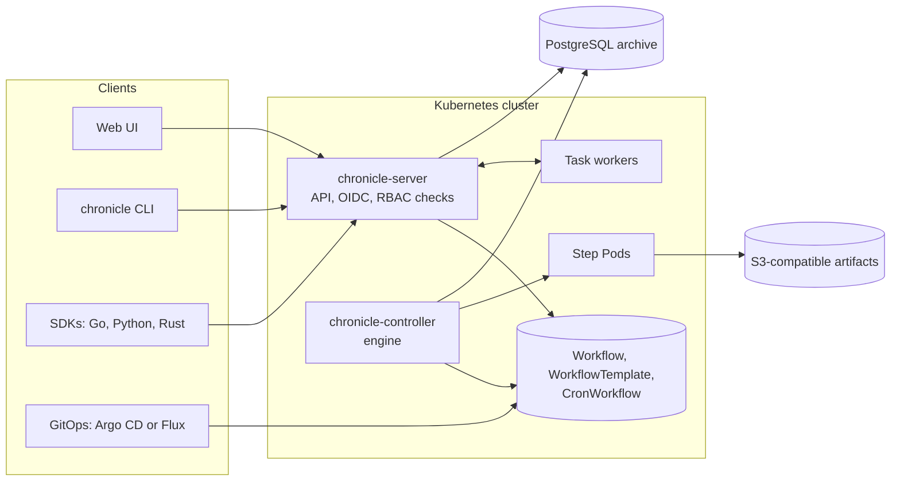

<p align="center">
  <picture>
    <source media="(prefers-color-scheme: dark)" srcset="docs/assets/logo-dark.svg">
    
  </picture>
</p>

<p align="center">
  <em>A Kubernetes-native workflow engine. Workflows in YAML or in Go, Python and Rust. Retry and re-run from any step.</em>
</p>

<p align="center">
  <a href="https://github.com/Thinnesen/chronicle/releases"></a>
  
  
  
</p>

---

## What is chronicle?

chronicle runs workflows on Kubernetes. A workflow is a DAG or a list of steps. Each step runs as a Pod, or as a
function in a long-running worker process. Workflows, templates and schedules are custom resources, so `kubectl` and
GitOps tools manage them like other Kubernetes objects. The controller keeps each run with its attempts and
outputs, so you can retry or re-run any part of it later.

There are two ways to write workflows, and you can mix them:

- **YAML**: keep the workflows in Git and deploy them with Argo CD or Flux.
- **Code**: build workflows with the SDKs for Go, Python and Rust. Submit them, or render them to YAML.

## See it

All pictures come from real runs on a small test cluster.

A run of a template from start to end (twice the real speed):


| Runs | A fan-out run |
|---|---|
|  |  |
| **Logs of a failed attempt** | **Timeline with a retry** |
|  |  |

The CLI submits a run from a template, follows it to the end, and reads its logs:


## Quick start

You need a Kubernetes 1.37 cluster, kubectl and Helm. A local [Kind](https://kind.sigs.k8s.io) 0.33 cluster is enough.

```sh
kind create cluster --name chronicle

# The admission webhook needs cert-manager.
helm repo add jetstack https://charts.jetstack.io
helm install cert-manager jetstack/cert-manager --version v1.21.2 \
  --namespace cert-manager --create-namespace --set crds.enabled=true --wait

helm install chronicle oci://ghcr.io/thinnesen/charts/chronicle --version 0.1.0 \
  --namespace chronicle-system --create-namespace --wait
```

Run a first workflow with kubectl. A DAG with two steps that run in parallel after the first one:

```yaml
# hello.yaml
apiVersion: chronicle.thinnesen.com/v1alpha1
kind: Workflow
metadata:
  generateName: hello-
spec:
  entrypoint: main
  templates:
  - name: main
    dag:
      tasks:
      - {name: fetch, template: say, arguments: {parameters: [{name: text, value: fetching}]}}
      - {name: left, template: say, depends: fetch, arguments: {parameters: [{name: text, value: left}]}}
      - {name: right, template: say, depends: fetch, arguments: {parameters: [{name: text, value: right}]}}
  - name: say
    inputs: {parameters: [{name: text}]}
    container:
      image: busybox:1.37@sha256:bdf57e528e45e4433820e045b29b4597825a1c9e38353532d90a01445013f82e
      command: [sh, -c, 'echo "$TEXT"']
      env: [{name: TEXT, value: "{{inputs.parameters.text}}"}]
```

```sh
kubectl create namespace demo
kubectl create -n demo -f hello.yaml
kubectl get workflows -n demo -w
```

The web UI and the CLI need a login: OIDC (any provider) or Microsoft Entra ID, set in the Helm values. Service
account tokens work for the CLI and the SDKs without a login provider. See [`docs/install.md`](docs/install.md).

## Features

Workflows:

- DAGs (`dependencies`, or `depends` conditions on the result of other tasks) and step lists
- Container, script, resource (create, apply or delete Kubernetes objects), HTTP, suspend and child workflow templates
- Task templates: the step runs as a function in a worker process of the Go, Python or Rust SDK, with heartbeats,
  timeouts and at-least-once delivery
- Parameters, outputs, workflow outputs, and parameters from labeled ConfigMaps
- Conditions (`when`), and fan-out with `withItems`, `withParam` and `withSequence`
- Retries with backoff, timeouts, deadlines, `continueOn`, and exit handlers for the run and for each task
- Approvals with typed values (`enum`), recorded with the name of the approver
- Artifacts in an S3-compatible store for each namespace, and an archive of step logs
- Step cache (`memoize`), parallelism limits, mutexes and semaphores for runs and for templates
- Shared volumes for the steps of a run (`volumeClaimTemplates`), and `emptyDir`, `secret` and `configMap` volumes
- Workflow templates, cluster workflow templates, and cron workflows with time zones, concurrency policies and backfill
- Delayed start (`startAt`), Pod garbage collection and TTL

Runs and history:

- Retry the failed steps, or retry from any step. With the archive, each earlier try stays readable.
- Re-run with changed parameters
- Suspend, resume, stop (with the exit handler) and terminate
- A PostgreSQL archive keeps finished runs and their tries after the Kubernetes objects are deleted. Step logs can
  stay in the artifact store.
- The UI and the CLI show why a step does not start, for example an image pull error or no node that fits

Access and security:

- Every API call runs as the caller (Kubernetes impersonation). Permissions are Kubernetes RBAC, the same as for
  `kubectl`.
- OIDC login with PKCE for the UI, the device flow for the CLI, and service account tokens for automation
- Microsoft Entra ID with group overage through Microsoft Graph
- Teams: Helm values bind IdP groups to the viewer, editor and admin roles in the namespaces of a team
- Workflow Pods run under the "restricted" Pod security standard. They get an API token only for a resource step,
  or when the run names a service account.
- Schedules that Argo CD or Flux manage cannot be changed from the UI or the API. The UI marks managed templates.

Operations:

- Prometheus metrics, Grafana dashboards and Kubernetes Events
- OpenTelemetry traces: one trace for each run. Steps and task workers get the trace context.
- Helm chart, signed multi-arch images, SBOMs and build provenance

Interfaces:

- Web UI: runs, a live graph, a timeline, logs, templates, schedules and task queues
- CLI: `chronicle submit`, `list`, `get`, `watch`, `logs`, `retry`, `rerun`, `approve` and more. `chronicle lint`
  checks workflow files without a server.
- SDKs for Go, Python and Rust: define and submit workflows, and run task workers
- API: Connect-RPC (gRPC and HTTP/JSON)

## Architecture



- The controller runs a pure workflow engine: it takes the spec, the status and the observed Pods and tasks, and
  returns actions. The controller applies them.
- The server serves the API and the UI. It calls Kubernetes as the caller and has no permissions of its own on runs.
- The archive database is optional. Task templates, the archive and shared login sessions need it.

The design is in [`docs/DESIGN.md`](docs/DESIGN.md). Each design change is in [`docs/DECISIONS.md`](docs/DECISIONS.md).

## Documentation

| Topic | Guide |
|---|---|
| Install the server, the CLI and the SDKs | [`docs/install.md`](docs/install.md) |
| Write workflows: DAGs, steps, parameters, retries, approvals, locks, volumes | [`docs/workflows.md`](docs/workflows.md) |
| Run chronicle in production: images, login, archive, replicas, upgrades | [`docs/operations.md`](docs/operations.md) |
| Artifacts and archived logs in S3 | [`docs/artifacts.md`](docs/artifacts.md) |
| Task workers in Go, Python and Rust | [`docs/task-workers.md`](docs/task-workers.md) |
| Login with Microsoft Entra ID and teams | [`docs/entra-id.md`](docs/entra-id.md) |
| GitOps with Argo CD (app of apps) | [`docs/gitops.md`](docs/gitops.md) |
| Metrics, events, dashboards and traces | [`docs/observability.md`](docs/observability.md) |
| SDK references | [`sdk/go`](sdk/go/README.md), [`sdk/python`](sdk/python/README.md), [`sdk/rust`](sdk/rust/README.md) |

## Status

chronicle 0.1.0 is the first release. The API is `v1alpha1`: it can still change in a minor release, and the release
notes describe each change.

Planned:

- Durable workflow code with deterministic replay, in addition to task workers
- Event triggers: webhooks, message queues and object store events
- Edits of GitOps-managed resources from the UI as pull requests
- Runs across clusters

## Contributing

See [CONTRIBUTING.md](CONTRIBUTING.md) for the setup, the tests and the conventions. Bug reports and feature requests
go to the [issues](https://github.com/Thinnesen/chronicle/issues).

## Security

Report vulnerabilities privately, as described in [SECURITY.md](SECURITY.md).

## License

[Apache License 2.0](LICENSE)
