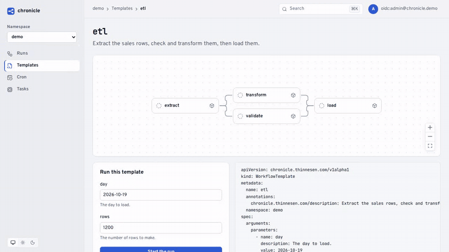
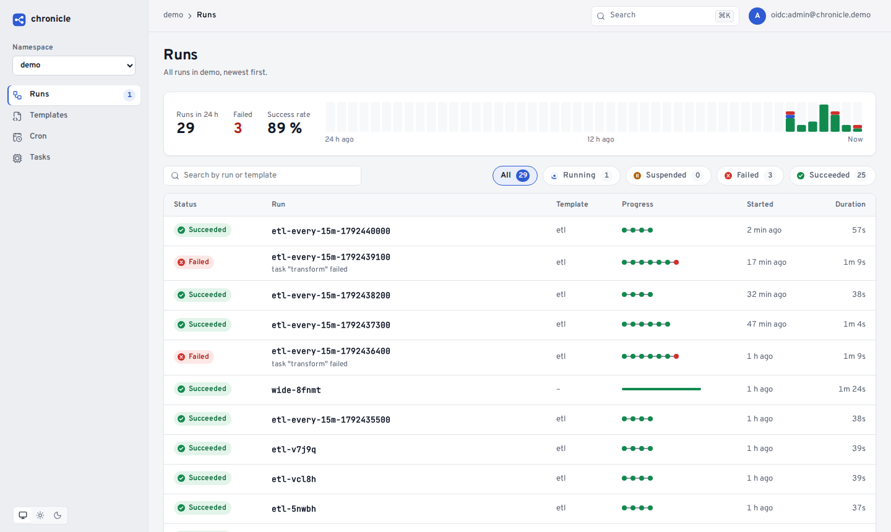
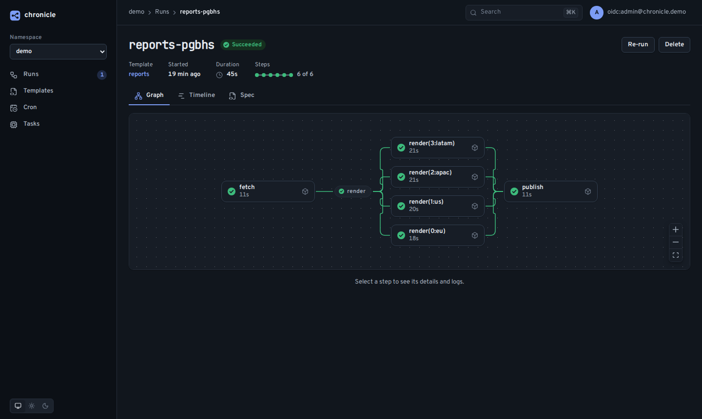
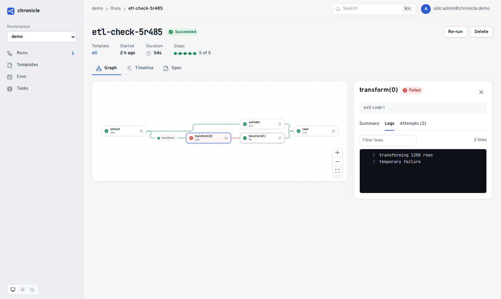
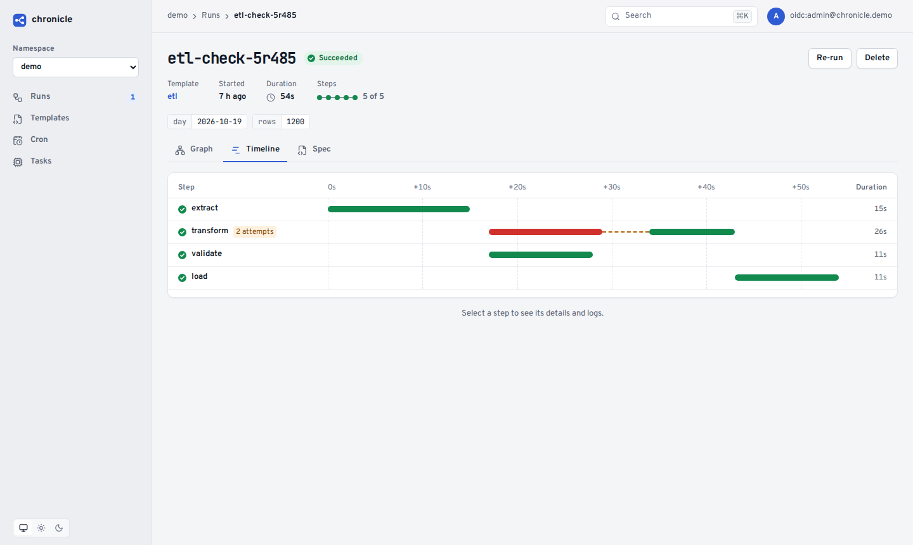
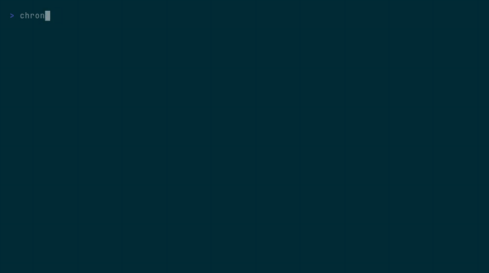
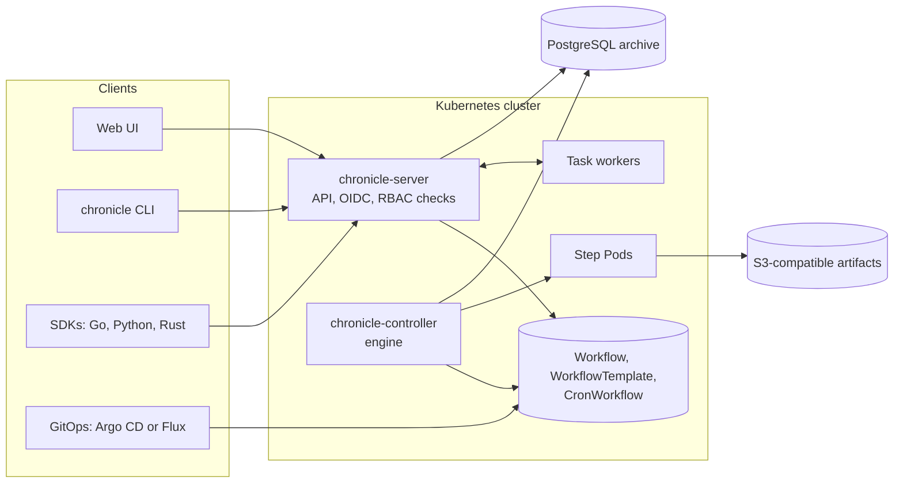

<p align="center">
  <picture>
    <source media="(prefers-color-scheme: dark)" srcset="docs/assets/logo-dark.svg">
    
  </picture>
</p>

<p align="center">
  <em>A Kubernetes-native workflow engine. Write workflows in YAML for GitOps, or in Go, Python or Rust. Retry and re-run from any step.</em>
</p>

<p align="center">
  
  
  
  
</p>

---

> **chronicle has no release yet.** The first version (milestones M1 to M8) is complete on the `dev` branch. It is in review. The design is in [`docs/DESIGN.md`](docs/DESIGN.md).

## What chronicle is

chronicle runs workflows on Kubernetes. Each step runs as a Pod. Workflows, templates and schedules are custom resources, so `kubectl`, Argo CD and Flux manage them like other Kubernetes objects. The controller keeps the history of each run, so you can retry or re-run any part of it later.

You can use chronicle in two ways, and you can mix them:

- **Simple, with YAML and GitOps**, as with Argo Workflows. Keep the workflows in Git and let Argo CD or Flux deploy them. You need no code and no Helm templates.
- **Advanced, with code**, as with Dagster. Build workflows in Go, Python or Rust with the SDKs, with the loops, functions and tests of your language. Submit them, or render them to YAML for Git.

A `task` step adds durable work, as Temporal activities do. It gives the work to a long-running worker in your own program, with heartbeats, timeouts and retries. One engine runs all of this, with one history, one UI and one CLI.

Features:

- **Runs** DAGs, step lists and cron workflows as Kubernetes Pods. It has retries, timeouts, exit handlers, approvals, fan-out, a step cache, parallelism limits, locks (one deployment at a time) and shared volumes. Steps can also apply Kubernetes objects or send HTTP requests, for example a chat message when a run ends. A step can start a child run of another template and wait for its outputs, and a run can wait for a start time.
- **Remembers** every run, every attempt, its logs and its outputs. Retry the failed steps, retry from any step, or re-run with changed parameters.
- **Shows what needs you**: the runs that wait for an approval, and the steps that Kubernetes cannot start. The UI and the CLI show the reason, for example a missing image.
- **Fits your observability**: Prometheus metrics, Kubernetes Events and OpenTelemetry traces. Each run is one trace, and your steps and task workers can add their own spans to it.
- **Logs you in properly**: OIDC with PKCE for the UI, and the device flow for the CLI. Microsoft 365 (Entra ID) is a first-class provider. Permissions are plain Kubernetes RBAC, the same as for `kubectl` and GitOps.
- **Keeps teams apart**: a few lines of Helm values map an IdP group to a team and its namespaces. Each team sees and runs only its own work, and a person in several teams sees all their runs on one page.
- **Stays GitOps-first**: every definition is a custom resource. Deploy it with Argo CD or Flux, as an app of apps. Resources from Git are read-only in the UI, and runs work from both.
- **Speaks your language**: the SDKs for Go, Python and Rust define and submit workflows as code. They also run durable task workers with heartbeats and retries.
- **Migrates from Argo**: `chronicle convert` turns Argo Workflows YAML into chronicle resources. `chronicle lint` checks your files in CI without a server.

## See it

The web UI shows the runs of a namespace. For each run, it shows a live graph, a timeline and the logs of the steps. All pictures come from real runs on a small demo cluster.

A run of the `etl` template from start to end (twice the real speed):



| Runs | A fan-out run |
|---|---|
|  |  |
| **Logs of a failed attempt** | **Timeline with a retry** |
|  |  |

The CLI submits a run from a template, follows it to the end, and reads its logs:



## Quick start

You need a Kubernetes cluster, kubectl and Helm. A local [Kind](https://kind.sigs.k8s.io) cluster is enough.

```sh
kind create cluster --name chronicle

# The admission webhook needs cert-manager.
helm repo add jetstack https://charts.jetstack.io
helm install cert-manager jetstack/cert-manager --version v1.21.2 \
  --namespace cert-manager --create-namespace --set crds.enabled=true --wait

helm install chronicle oci://ghcr.io/thinnesen/charts/chronicle --version 0.1.0 \
  --namespace chronicle-system --create-namespace --wait
```

Run a first workflow with kubectl. A DAG with two steps that run in parallel after the first one:

```yaml
# hello.yaml
apiVersion: chronicle.thinnesen.com/v1alpha1
kind: Workflow
metadata:
  generateName: hello-
spec:
  entrypoint: main
  templates:
  - name: main
    dag:
      tasks:
      - {name: fetch, template: say, arguments: {parameters: [{name: text, value: fetching}]}}
      - {name: left, template: say, depends: fetch, arguments: {parameters: [{name: text, value: left}]}}
      - {name: right, template: say, depends: fetch, arguments: {parameters: [{name: text, value: right}]}}
  - name: say
    inputs: {parameters: [{name: text}]}
    container:
      image: busybox:1.37@sha256:bdf57e528e45e4433820e045b29b4597825a1c9e38353532d90a01445013f82e
      command: [sh, -c, 'echo "$TEXT"']
      env: [{name: TEXT, value: "{{inputs.parameters.text}}"}]
```

```sh
kubectl create namespace demo
kubectl create -n demo -f hello.yaml
kubectl get workflows -n demo -w
```

The web UI and the CLI need a login. Configure OIDC in the Helm values, with any provider or with Microsoft Entra ID. See [`docs/install.md`](docs/install.md) and the values of the Helm chart in [`dist/chart/values.yaml`](dist/chart/values.yaml).

## Docs

| Topic | Guide |
|---|---|
| Install the CLI and the SDKs | [`docs/install.md`](docs/install.md) |
| Write workflows: DAGs, steps, parameters, retries, approvals, locks, volumes | [`docs/workflows.md`](docs/workflows.md) |
| Run chronicle in production: images, login, archive, replicas, upgrades | [`docs/operations.md`](docs/operations.md) |
| Artifacts and archived logs in S3 | [`docs/artifacts.md`](docs/artifacts.md) |
| Task workers in Go, Python and Rust | [`docs/task-workers.md`](docs/task-workers.md) |
| Login with Microsoft Entra ID and teams | [`docs/entra-id.md`](docs/entra-id.md) |
| GitOps with Argo CD (app of apps) | [`docs/gitops.md`](docs/gitops.md) |
| Metrics, events, dashboards and traces | [`docs/observability.md`](docs/observability.md) |
| Move from Argo Workflows | [`docs/argo-migration.md`](docs/argo-migration.md) |
| Design and decisions | [`docs/DESIGN.md`](docs/DESIGN.md), [`docs/DECISIONS.md`](docs/DECISIONS.md) |

## How it fits together



## Status

chronicle 0.1.0 is the first public release. The API is `v1alpha1`: it can still change in a minor release, and the
release notes describe each change.

Next on the roadmap:

- Durable workflow code with deterministic replay, in addition to task workers.
- Event triggers: webhooks, message queues and object store events.
- Edits of GitOps-managed resources from the UI as pull requests.
- Runs across clusters.

Ideas and feedback are welcome in the [issues](https://github.com/Thinnesen/chronicle/issues).

## Development

See [CONTRIBUTING.md](CONTRIBUTING.md) for the setup, the tests and the conventions. Report security problems as
described in [SECURITY.md](SECURITY.md).

## License

Apache License 2.0.
