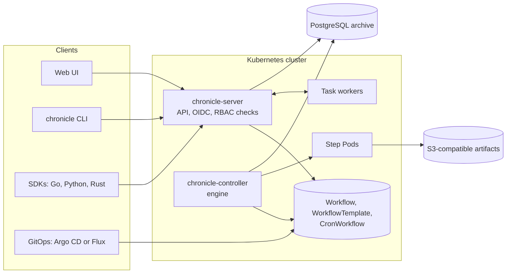

<p align="center">
  <picture>
    <source media="(prefers-color-scheme: dark)" srcset="docs/assets/logo-dark.svg">
    
  </picture>
</p>

<p align="center">
  <em>Kubernetes-native workflow engine: DAG, step and cron workflows as CRDs, retry and re-run from any step, run archive in PostgreSQL, S3 artifacts, OIDC with Kubernetes RBAC, and SDKs for Go, Python and Rust.</em>
</p>

<p align="center">
  
  
  
  
</p>

---

> **chronicle has no release yet.** The first version (milestones M1 to M8) is complete on the `dev` branch and is in review. The design is in [`docs/DESIGN.md`](docs/DESIGN.md).

## What chronicle is

chronicle runs workflows on Kubernetes. Each step runs as a Pod. Workflows, templates and schedules are custom resources, so `kubectl`, Argo CD and Flux manage them like other Kubernetes objects. The controller keeps the history of each run, so you can retry or re-run any part of it later.

Features:

- **Runs** DAGs, step lists and cron workflows as Kubernetes Pods, with retries, timeouts, exit handlers, approvals and fan-out.
- **Remembers** every run, every attempt, its logs and its outputs. Retry the failed steps, retry from any step, or re-run with changed parameters.
- **Logs you in properly**: OIDC with PKCE for the UI and the device flow for the CLI, with first-class Microsoft 365 (Entra ID) support. Permissions are plain Kubernetes RBAC, the same as for `kubectl` and GitOps.
- **Keeps teams apart**: map an Entra or other IdP group to a team and its namespaces in a few lines of Helm values. Each team sees and runs only its own work.
- **Stays GitOps-first**: every definition is a custom resource. Deploy it with Argo CD or Flux, as an app of apps. Resources from Git are read-only in the UI, and runs work from both.
- **Speaks your language**: SDKs for Go, Python and Rust define and submit workflows as code, and run durable task workers with heartbeats and retries.
- **Migrates from Argo**: `chronicle convert` turns Argo Workflows YAML into chronicle resources.

## See it

The web UI shows the runs of a namespace, a live graph and a timeline of each run, and the logs of each step. All pictures come from real runs on a small demo cluster.

| Runs | A fan-out run |
|---|---|
|  |  |
| **Logs of a failed attempt** | **Timeline with a retry** |
|  |  |

The CLI submits a run from a template, follows it to the end, and reads its logs:


## Quick start

You need Docker, [Kind](https://kind.sigs.k8s.io), kubectl and Helm. There are no published images yet, so you build the image yourself.

```sh
git clone https://github.com/Thinnesen/chronicle && cd chronicle
kind create cluster --name chronicle
make docker-build IMG=chronicle:dev && kind load docker-image chronicle:dev --name chronicle

# The admission webhook needs cert-manager.
helm repo add jetstack https://charts.jetstack.io
helm install cert-manager jetstack/cert-manager --version v1.21.2 \
  -n cert-manager --create-namespace --set crds.enabled=true --wait

helm install chronicle dist/chart -n chronicle-system --create-namespace --wait \
  --set manager.image.repository=chronicle --set manager.image.tag=dev --set manager.image.pullPolicy=Never
```

Run a first workflow with kubectl. A DAG with two steps that run in parallel after the first one:

```yaml
# hello.yaml
apiVersion: chronicle.thinnesen.com/v1alpha1
kind: Workflow
metadata:
  generateName: hello-
spec:
  entrypoint: main
  templates:
  - name: main
    dag:
      tasks:
      - {name: fetch, template: say, arguments: {parameters: [{name: text, value: fetching}]}}
      - {name: left, template: say, depends: fetch, arguments: {parameters: [{name: text, value: left}]}}
      - {name: right, template: say, depends: fetch, arguments: {parameters: [{name: text, value: right}]}}
  - name: say
    inputs: {parameters: [{name: text}]}
    container:
      image: busybox:1.37@sha256:bdf57e528e45e4433820e045b29b4597825a1c9e38353532d90a01445013f82e
      command: [sh, -c, 'echo "$TEXT"']
      env: [{name: TEXT, value: "{{inputs.parameters.text}}"}]
```

```sh
kubectl create namespace demo
kubectl create -n demo -f hello.yaml
kubectl get workflows -n demo -w
```

To use the web UI and the CLI, configure a login with OIDC (any provider, or Microsoft Entra ID) in the Helm values. See [`docs/install.md`](docs/install.md) and the values of the Helm chart in [`dist/chart/values.yaml`](dist/chart/values.yaml).

## Docs

| Topic | Guide |
|---|---|
| Write workflows: DAGs, steps, parameters, retries, approvals, locks | [`docs/workflows.md`](docs/workflows.md) |
| Artifacts and archived logs in S3 | [`docs/artifacts.md`](docs/artifacts.md) |
| Task workers in Go, Python and Rust | [`docs/task-workers.md`](docs/task-workers.md) |
| Login with Microsoft Entra ID and teams | [`docs/entra-id.md`](docs/entra-id.md) |
| GitOps with Argo CD (app of apps) | [`docs/gitops.md`](docs/gitops.md) |
| Metrics, events, dashboards and traces | [`docs/observability.md`](docs/observability.md) |
| Move from Argo Workflows | [`docs/argo-migration.md`](docs/argo-migration.md) |
| Design and decisions | [`docs/DESIGN.md`](docs/DESIGN.md), [`docs/DECISIONS.md`](docs/DECISIONS.md) |

## How it fits together



## Roadmap

| Milestone | Scope |
|---|---|
| [M1 Engine core](https://github.com/Thinnesen/chronicle/milestone/1) | API, DAG and steps engine, Pods, retries, timeouts, exit handlers, suspend and approve |
| [M2 Scheduling and templates](https://github.com/Thinnesen/chronicle/milestone/2) | CronWorkflow, template references, cluster templates |
| [M3 Server, login and CLI](https://github.com/Thinnesen/chronicle/milestone/3) | Connect-RPC API, OIDC, RBAC through SubjectAccessReview, CLI, logs, audit |
| [M4 Web UI](https://github.com/Thinnesen/chronicle/milestone/4) | Runs, live DAG graph, logs, actions, templates, cron |
| [M5 History and re-runs](https://github.com/Thinnesen/chronicle/milestone/5) | PostgreSQL archive, retry from step, re-run, artifacts |
| [M6 SDKs and Argo migration](https://github.com/Thinnesen/chronicle/milestone/6) | Go, Python and Rust SDKs, `chronicle convert` |
| [M7 Durable task workers](https://github.com/Thinnesen/chronicle/milestone/7) | Task queue, workers with heartbeats and timeouts |
| [M8 Release readiness](https://github.com/Thinnesen/chronicle/milestone/8) | Helm chart, app-of-apps example, observability, e2e, security review |

## Development

Run `make test lint` before a change. For the UI, run `pnpm lint`, `pnpm typecheck` and `pnpm test` in `ui/`. Docs, comments and commits use ASD-STE100 Simplified Technical English.

## License

Apache License 2.0.
