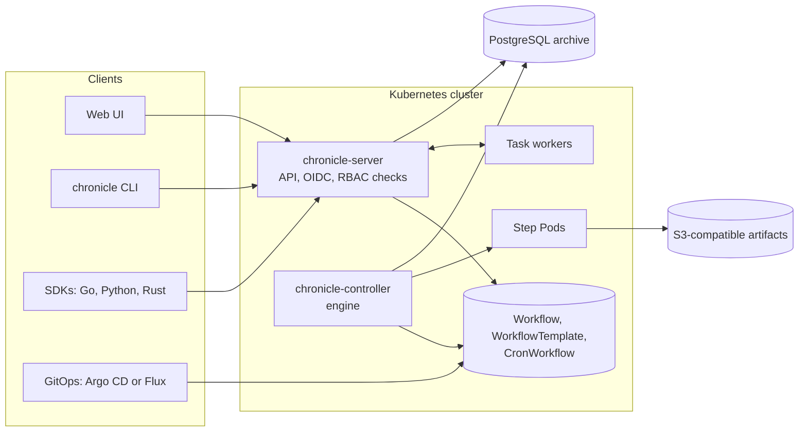

  <picture>
    <source media="(prefers-color-scheme: dark)" srcset="docs/assets/logo-dark.svg">
    
  </picture>

  <em>Workflows for Kubernetes that remember every run: DAGs, cron and durable tasks, a UI you want to use, and GitOps from day one.</em>

  
  
  
  

---

> **chronicle is in development.** The plan is in [`docs/DESIGN.md`](docs/DESIGN.md), and the work is tracked in the [issues](https://github.com/Thinnesen/chronicle/issues) and [milestones](https://github.com/Thinnesen/chronicle/milestones). Demos from real runs come with the first usable version.

## Why chronicle

Argo Workflows made Kubernetes workflows popular. Teams also know its weak spots: a hard SSO and RBAC setup, a UI that gets in the way, and few ways to re-run work safely. Temporal and Dagster are great for workflows as code, but they live beside Kubernetes, not in it.

chronicle takes the good parts of each:

- **Runs** DAGs, step lists and cron workflows as Kubernetes Pods, with retries, timeouts, exit handlers, approvals and fan-out.
- **Remembers** every run, every attempt, its logs and its outputs. Retry the failed steps, retry from any step, or re-run with changed parameters.
- **Logs you in properly**: OIDC with PKCE for the UI and the device flow for the CLI, with first-class Microsoft 365 (Entra ID) support. Permissions are plain Kubernetes RBAC, the same as for `kubectl` and GitOps.
- **Keeps teams apart**: map an Entra or other IdP group to a team and its namespaces in a few lines of Helm values. Each team sees and runs only its own work.
- **Stays GitOps-first**: every definition is a custom resource. Deploy it with Argo CD or Flux, as an app of apps. Resources from Git are read-only in the UI, and runs work from both.
- **Speaks your language**: SDKs for Go, Python and Rust define and submit workflows as code, and run durable task workers with heartbeats and retries.
- **Migrates from Argo**: `chronicle convert` turns Argo Workflows YAML into chronicle resources.

## How it fits together

## Roadmap

| Milestone | Scope |
|---|---|
| [M1 Engine core](https://github.com/Thinnesen/chronicle/milestone/1) | API, DAG and steps engine, Pods, retries, timeouts, exit handlers, suspend and approve |
| [M2 Scheduling and templates](https://github.com/Thinnesen/chronicle/milestone/2) | CronWorkflow, template references, cluster templates |
| [M3 Server, login and CLI](https://github.com/Thinnesen/chronicle/milestone/3) | Connect-RPC API, OIDC, RBAC through SubjectAccessReview, CLI, logs, audit |
| [M4 Web UI](https://github.com/Thinnesen/chronicle/milestone/4) | Runs, live DAG graph, logs, actions, templates, cron |
| [M5 History and re-runs](https://github.com/Thinnesen/chronicle/milestone/5) | PostgreSQL archive, retry from step, re-run, artifacts |
| [M6 SDKs and Argo migration](https://github.com/Thinnesen/chronicle/milestone/6) | Go, Python and Rust SDKs, `chronicle convert` |
| [M7 Durable task workers](https://github.com/Thinnesen/chronicle/milestone/7) | Task queue, workers with heartbeats and timeouts |
| [M8 Release readiness](https://github.com/Thinnesen/chronicle/milestone/8) | Helm chart, app-of-apps example, observability, e2e, security review |

## Development

Run `make test lint` before a change. For the UI, run `pnpm lint`, `pnpm typecheck` and `pnpm test` in `ui/`. Docs, comments and commits use ASD-STE100 Simplified Technical English.

## License

Apache License 2.0.
